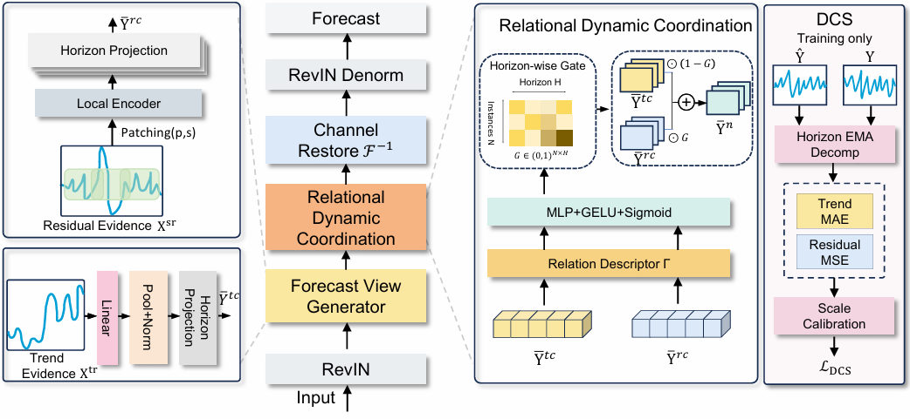
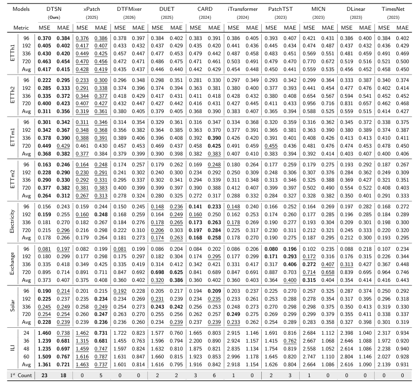

# DTSN
The code for **Rethinking Decomposition-Based Time Series Forecasting with Relational Dynamic Coordination**

## Usage
### Environment Setup
Create a Python 3.9 environment and install the project dependencies:

```bash
conda create -n DTSN python=3.9 -y
conda activate DTSN
pip install -r requirements.txt
```

### Prepare Dataset
All the datasets needed for DTSN can be obtained from the [Google Drive](https://drive.usercontent.google.com/download?id=1NF7VEefXCmXuWNbnNe858WvQAkJ_7wuP&export=download&authuser=0). Create a folder named `./dataset/` and place the downloaded files in this directory.

### Training Example
Execute the provided training scripts under `./scripts/`. For example:

```bash
sh ./scripts/ETTh1.sh
```

## Model Architecture
DTSN (Dynamic Trend-Seasonal Synergy Network) constructs aligned forecast views from decomposed historical evidence and adaptively coordinates their contributions. The framework consists of three main components:

<p align="center">

</p>


- **Forecast View Generator**: Applies exponential smoothing to normalized historical observations to obtain trend and seasonal-residual evidence. Two separate generators map this evidence into aligned forecasts of the same future observations over a shared prediction horizon.

- **Relational Dynamic Coordination (RDC)**: Describes the relationships between the two forecast views using their values, signed discrepancies, and element-wise products. A gating network generates coordination weights that vary across instances and future steps to adaptively combine the views.

- **Decomposition Consistency Supervision (DCS)**: During training, represents prediction errors through accumulated variations and a smoothed error trajectory. It combines residual MSE and trend MAE with a detached scaling coefficient to jointly optimize the forecast generators and RDC.

## Main Experimental Results

### Long-term Forecasting Results
Multivariate forecasting results on eight datasets. The input length is L = 36 for ILI and L = 96 for the other datasets. Prediction horizons are H ∈ {24, 36, 48, 60} for ILI and H ∈ {96, 192, 336, 720} for the other datasets. The best results are shown in bold, and the second-best results are underlined.

<div align=center>

</div>


## Acknowledgement

We appreciate the following github repos for their valuable code and effort:

- [xPatch](https://github.com/stitsyuk/xPatch)
- [TimesNet](https://github.com/thuml/TimesNet)
- [iTransformer](https://github.com/thuml/iTransformer)
- [PatchTST](https://github.com/yuqinie98/PatchTST)
